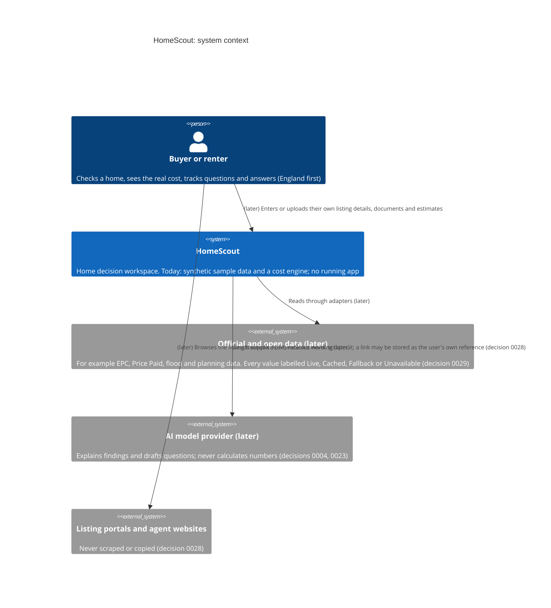
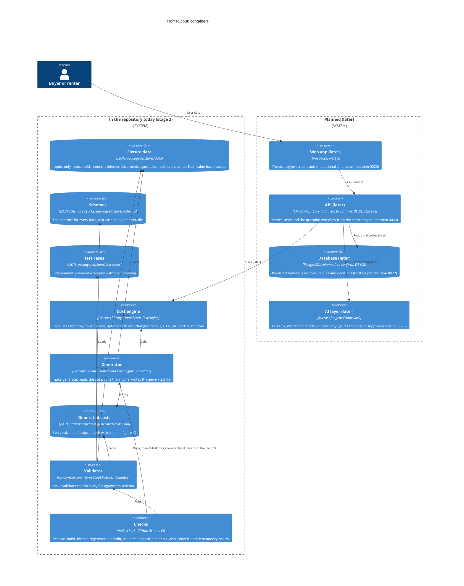

# Architecture (C4 diagrams)

Two diagrams in [Mermaid](https://mermaid.js.org/syntax/c4.html), following the [C4 model](https://c4model.com/): the **system context** (who and what HomeScout talks to) and the **containers** (the parts that run or hold data). Decision 0027 asks for them; they are updated as the system grows.

**How to read them.** Boxes marked **(later)** do not exist yet. Everything unmarked is in the repository today (stage 2). GitHub draws Mermaid diagrams on this page. Mermaid's C4 support is experimental, so if a diagram does not draw, the text under it says the same thing.

## 1. System context

- **People.** The buyer or renter is the only user. Buyers and renters have equal weight (doc 03).
- **What the user gives HomeScout.** Listing text they paste, documents they upload and figures they enter, processed privately and labelled by origin (decision 0028). HomeScout never scrapes or crawls portals or agent sites and never copies listing descriptions, photos or floor plans.
- **Outside services are later.** None is called today. When added, each sits behind one adapter, and each value carries a provenance label: **Live**, **Cached**, **Fallback** or **Unavailable**. Unavailable never looks like a clean result (decision 0029). Tests that call live services stay out of the merge gate.
- **AI** only explains, drafts and checks. Costs, comparisons and what changed come from the cost engine (decisions 0004, 0019, 0023).

## 2. Containers

**What exists now**

| Container | Where | What it does |
|---|---|---|
| Fixture data | `packages/fixtures/data/` | Hand-maintained inputs only; no totals (`AGENTS.md` rule 2). |
| Schemas | `packages/fixtures/schema/` | JSON Schema 2020-12 contract for data, test cases and generated output. |
| Test cases | `packages/fixtures/test-cases/` | Calculations worked out independently of the engine, so a wrong calculation cannot confirm itself. |
| Cost engine | `packages/cost-engine/src/HomeScout.CostEngine/` | The only place calculated figures come from (decision 0019). Architecture tests keep it free of I/O. |
| Generator | `packages/cost-engine/src/HomeScout.CostEngine.Generator/` | Turns the data into `costs.json`. |
| Generated costs | `packages/fixtures/generated/costs.json` | Committed output; never edited by hand. |
| Validator | `packages/fixtures/tools/HomeScout.Fixtures.Validator/` | Schema checks for `make validate`. |
| Checks | `Makefile`, `.github/workflows/` | `make check` locally and in CI; `make generated-check` fails if the committed output is out of date. |

**What is planned, and not built.** The Next.js web app (decision 0020), the ASP.NET Core API (planned; the framework is still to be confirmed at stage 6, BE-01), PostgreSQL (planned; to be confirmed, DA-03; hosting follows decision 0022: the founder's existing server first, Azure only where needed) and the AI layer (decision 0023). How the prototype is built is decided at stage 4 (IN-01); the recommended starting point is that it reads the generated file.
