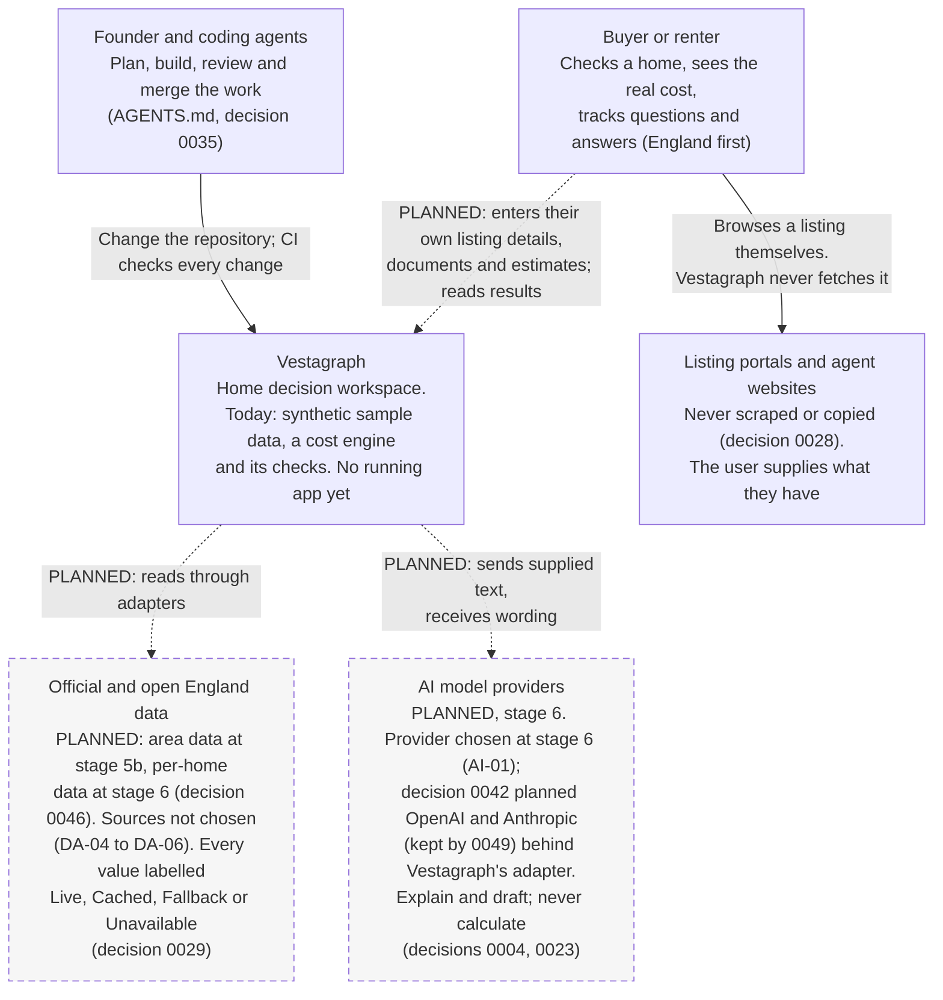
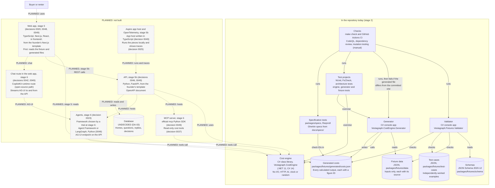

# Architecture (C4 diagrams)

Two diagrams that show how Vestagraph fits together, following the [C4 model](https://c4model.com/): first the **system context** (who and what Vestagraph talks to), then the **containers** (the separate parts that run or hold data). Decision 0027 asks for them, and they are updated as the system grows.

**How to read them.**
- A **solid box with a solid outline** exists in the repository today (stage 2).
- A **dashed box** is **planned**: it is decided or recommended, but nothing has been built. Each planned box names the stage and the decision that plans it.
- GitHub draws the diagrams from the Mermaid text on this page. If a diagram does not draw in your viewer, the plain-language text under it says the same thing.
- Planned boxes are not promises of a design. Where a choice is still open (for example the database), the box says so and names no product.

## 1. System context

"System context" is the widest view. It shows Vestagraph as one box, the people who use or build it, and the outside services it will talk to.

**In plain language**
- **The user** is the only end user. Buyers and renters have equal weight (doc 03).
- **The founder and the coding agents** are the other "people" in the picture, because today the repository and its automatic checks are the whole product. The rules they follow are in `AGENTS.md`.
- **The user supplies the listing.** Vestagraph never scrapes or crawls property portals or agent sites, and never copies listing text, photos or floor plans (decision 0028). People paste text, upload documents and enter figures themselves, and each value keeps a label saying where it came from.
- **Outside data services are planned.** None is called today. When one is added, it sits behind a single adapter, and every value it supplies is labelled **Live**, **Cached**, **Fallback** or **Unavailable**; "Unavailable" never looks like a clean result (decision 0029). The roadmap's first candidates are energy certificate data, then sold-price data, then planning and flood data (doc 04 §5), but no source or vendor is chosen.
- **AI model providers are planned.** AI explains findings and drafts questions. It never calculates a number: every figure comes from the cost engine (decisions 0004, 0019, 0023).

## 2. Containers

A "container" here means a separately runnable or storable part: a program, a library, a data file set or a pipeline. The top group is what exists now. The lower group is planned for later stages.

**What exists now**

| Container | Where | What it does |
|---|---|---|
| Fixture data | `packages/fixtures/data/` | Hand-maintained inputs only: household, homes, evidence, documents, questions, replies, the snapshot and synthetic area context. No totals (`AGENTS.md` rule 2). |
| Schemas | `packages/fixtures/schema/` | The contract: JSON Schema files for the data, the test cases and the generated output. |
| Test cases | `packages/fixtures/test-cases/` | Calculations worked out independently of the engine, with their working, so a wrong calculation cannot confirm itself. |
| Cost engine | `packages/cost-engine/src/Vestagraph.CostEngine/` | The only place calculated figures come from (decision 0019). Architecture tests keep it free of I/O. |
| Generator | `packages/cost-engine/src/Vestagraph.CostEngine.Generator/` | `make generate`: reads the data, calls the engine, writes `costs.json`. |
| Generated costs | `packages/fixtures/generated/costs.json` | The committed output. Never edited by hand. |
| Validator | `packages/fixtures/tools/Vestagraph.Fixtures.Validator/` | `make validate`: checks every data, test-case and generated file against its schema. |
| Test projects | `packages/cost-engine/tests/`, `packages/fixtures/tests/` | NUnit tests, FsCheck property tests, architecture tests and the generator's end-to-end tests. |
| Specification tests | `packages/specs/Vestagraph.Specs.Tests/` | Reqnroll runs the Gherkin specifications in `docs/specs/` (decision 0043); data steps check every cited figure and evidence ID against the fixtures and `costs.json`. |
| Checks | `Makefile`, `.github/workflows/`, repository settings | `make check` locally and in CI; `make generated-check` fails if the committed output is out of date. CodeQL (`actions` and `csharp`), dependency review and workflow linting also run. `make mutate` (Stryker.NET) is manual and not part of CI. |

**In plain language: how data flows today.** A person edits the inputs in the fixture data. The generator reads them, asks the cost engine to calculate every total (differences between homes are deferred to stage 5: BE-27, #96), and writes one file, `costs.json`. The validator checks that the inputs, the worked test cases and that output all match their schemas, and CI regenerates `costs.json` and fails if the committed copy is different. That is how the project keeps one rule: **inputs are typed once with a source; calculated figures only ever come from the engine.**

**What is planned, and not built**

| Planned part | Stage | Notes |
|---|---|---|
| Web app (Next.js, React) | 5 | The clickable prototype, run locally only in stage 5 (decision 0048). It starts from a one-time copy of the founder's Next.js template in `frontend/` and reads the fixture and generated files with no backend until stage 5b (decisions 0048, 0049). |
| API (Python, FastAPI) | 5b (area data), 6 (costs and questions) | Serves the public area check first (decision 0046), then costs and the questions workflow from the same engine. Starts from a one-time copy of the founder's FastAPI template (decisions 0040, 0049, #93); TypeScript types for the web app are generated from the API's OpenAPI document (decision 0042). |
| MCP server | 6 | Built with the official `mcp` Python SDK, exposing read-only cost tools so other tools and agents can use the engine (decisions 0037, 0038, 0049). |
| Agents and chat | 6 | Microsoft Agent Framework for Python or LangChain with LangGraph, chosen by a short trial at stage 6 (decisions 0023, 0049). The API streams agent replies over AG-UI; the web app talks to it through a CopilotKit runtime route, using the open-source path only (decision 0042). Agents quote only figures the engine supplied. |
| Aspire and OpenTelemetry | 5b | Local app host, written in TypeScript, and trace dashboard for the pieces above (decisions 0025, 0049). |
| Database | 6 | Not decided (DA-03). It would hold homes, questions, replies and decisions once there is real data; hosting follows decision 0022 (cost first). |

The planned pieces and their order are in the [ordered backlog](../planning/backlog.md). Until the Python port (decision 0049) removes the .NET code (port step P8), the built pieces above stay in C#.

## Keeping this page true

Update the diagrams in the same pull request that adds, removes or renames a container or an outside service, and move a box out of the dashed group when it is built. Do not add a vendor to a planned box until a decision record chooses it.
